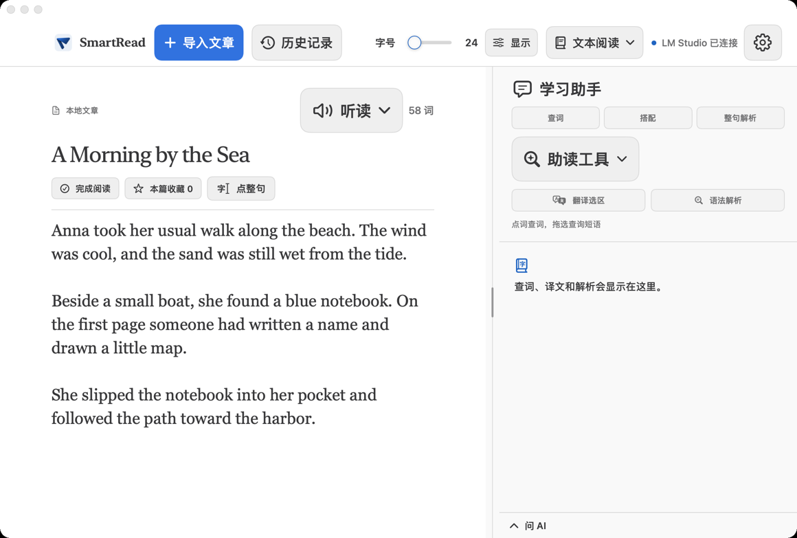
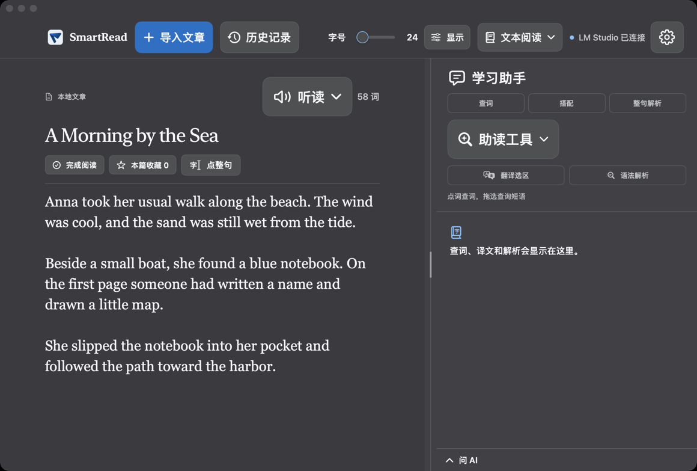

# SmartRead

SmartRead 是一款原生 macOS 英语学习应用。你可以用自己的文章、PDF、音频和视频学习英语，在同一个界面查词、看句子解析，或就原文向本机模型追问。

[中文使用指南](docs/guide-zh.md) · [从源码构建](#从源码构建) · [English overview](#english-overview)



<details>
<summary>查看深灰色主题</summary>



</details>

## 主要功能

| 学习模式 | 可以做什么 |
| --- | --- |
| 文本阅读 | 导入公开网页、纯文本、Markdown 或 PDF。扫描页在本机 OCR，可按顺序框选多栏内容。PDF 电子书支持翻页、按章阅读和恢复进度。英文正文可用系统语音或 Kokoro 听读。 |
| 音频精听 | 导入 MP3 或 MP4 音轨，在支持的 Mac 上生成英文字幕。按句跟听、隐藏字幕练盲听，也能修正字幕文字和时间。 |
| 视频精学 | 播放本机 MP4、MOV、M4V、MKV，加载外置 SRT 或提取内嵌文字字幕。支持双语字幕、字幕校时、查找台词和单句循环。 |

三个模式共用学习助手和播放快捷键。空格播放或暂停，← 和 → 逐句跳转，↓ 重听，↑ 在 0.75× 和原速之间切换。选中单词、短语或句子后，可用 LM Studio 查询语境释义、翻译、解析和追问。收藏保存在本机，也可配置 Obsidian 导出。

盲听时双按 **↓** 或按 **M** 标记当前句，播放照常继续，并轻响一声确认。顶栏「听力标记」汇总当前素材的标记和可能卡住的句子，可以查看重听次数、逐句定位、重听及收藏原句。

## 从源码构建

SmartRead 支持 **macOS 14 或更新版本**，使用 SwiftUI 和 AppKit。请先安装 Xcode 或 Xcode Command Line Tools。要构建音频自动转写功能，需要含 macOS 26 SDK 的工具链，例如 Xcode 26 或更新版本。

```sh
git clone https://github.com/Vladchen2022/SmartRead.git
cd SmartRead
./Scripts/build-app.sh "$PWD/dist/SmartRead.app"
open "$PWD/dist/SmartRead.app"
```

首次构建会从 VideoLAN 下载并校验 VLCKit。生成的 App 会使用本地临时签名，可从 Finder 移到「应用程序」。

## 首次使用

1. 用顶栏的学习模式菜单选择「文本阅读」「音频精听」或「视频精学」，然后导入你的素材。
2. 使用 AI 学习助手时，在 LM Studio 里加载模型并启动本机服务器，再到 SmartRead 的「设置 → LM Studio」测试连接、选择模型。默认地址是 `http://127.0.0.1:1234/v1`。查词、翻译、解析和追问会把所需片段发送到你配置的模型地址。
3. 去「设置 → 界面与阅读」选择白色或深灰色主题，调整字号和助手宽度。

**可选功能的要求**

- **音频自动转写**需要 macOS 26 或更新版本及支持 Apple 语音转写的 Mac。
- **提取视频内嵌文字字幕**需要 FFmpeg。外置 SRT 可直接导入。
- **Kokoro 听读**需要先安装 `uv`，再运行 `bash Scripts/setup-kokoro.sh` 下载本机运行环境和语音模型。系统语音开箱即用。

## 开发与测试

```sh
./Scripts/bootstrap-vlckit.sh
swift test
```

测试覆盖文章导入与阅读进度、PDF 和 OCR、字幕与播放、模型请求和收藏导出。需要本机模型或额外 PDF、媒体样本的集成测试会在缺少相应条件时跳过。欢迎在 [Issues](https://github.com/Vladchen2022/SmartRead/issues) 报告问题，附上 macOS 版本、学习模式和复现步骤。

## 许可证

SmartRead 原创源码采用 [MIT 许可证](LICENSE)。网页提取使用 [Mozilla Readability 0.6.0](https://github.com/mozilla/readability/tree/0.6.0)，遵循 [Apache 2.0](Sources/SmartRead/Resources/Readability-APACHE-2.0.txt)，仓库保留[原始版权声明](Sources/SmartRead/Resources/Readability-LICENSE.md)。视频播放使用 [VideoLAN VLCKit](https://github.com/videolan/vlckit)，其 LGPL 2.1 许可证随本机构建的 App 一起打包。可选语音使用 [kokoro-onnx](https://github.com/thewh1teagle/kokoro-onnx) 和 [Kokoro-82M](https://huggingface.co/hexgrad/Kokoro-82M)。

## English overview

SmartRead is a native macOS app for learning English from your own articles, PDFs, audio, and videos. It supports on-device OCR for scanned PDFs, sentence-by-sentence listening, bilingual video subtitles, and contextual questions through LM Studio. The interface is in Simplified Chinese, with white and dark gray themes.

Build on macOS using the [commands above](#从源码构建). The app runs on macOS 14 or later. Automatic audio transcription requires macOS 26 or later and a supported Mac. Source code is available under the [MIT license](LICENSE).
